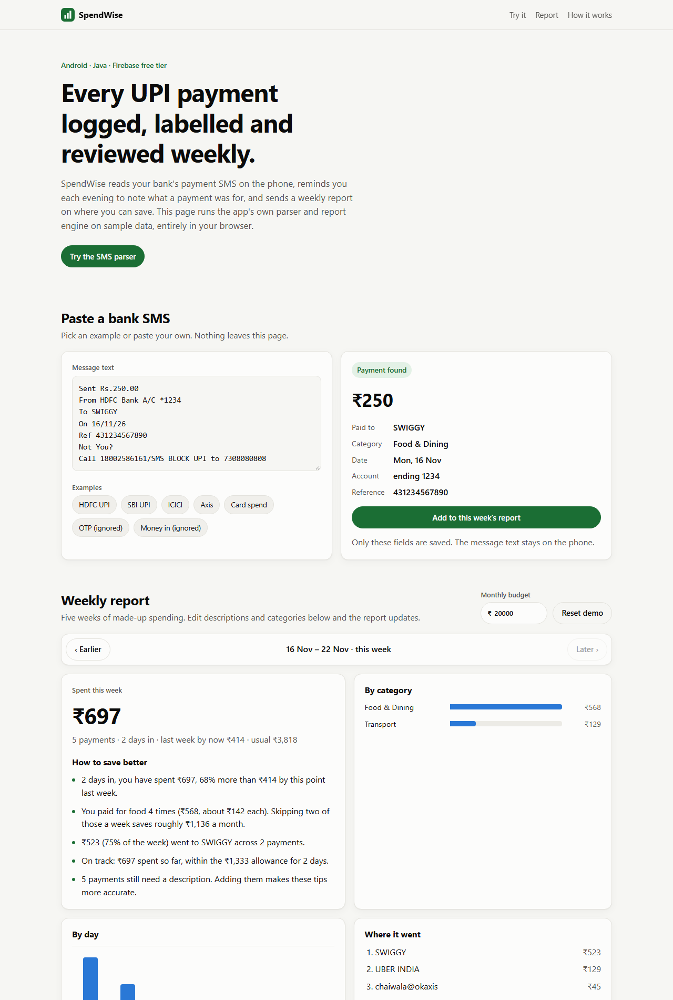
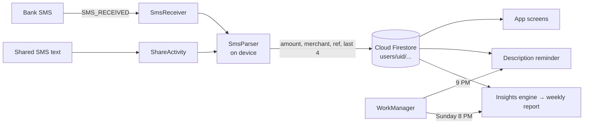

# SpendWise

An Android expense tracker that logs UPI and card payments automatically from bank SMS alerts,
reminds you each evening to describe them, and sends a weekly report with concrete ways to save.

Built in Java on Firebase's free Spark plan: no servers, no billing account, no running cost.

**Try it:** [web demo](https://spendwise-87444.web.app) (runs the real parser and report engine in your browser)
· [Android demo APK](../../releases/latest)



## Features

- **Automatic capture.** Bank debit SMS are parsed on the phone (HDFC, SBI, ICICI, Axis, Kotak and similar formats).
  OTPs, credits, mandate reminders, failed payments and messages from personal numbers are ignored.
- **Share to add.** Long-press any bank SMS, tap Share, pick SpendWise. Works without SMS permission.
- **Evening reminder.** At 9 PM, if any payment has no description, a notification opens the list filtered to them.
- **Learns your categories.** Pick a category once and future payments to that merchant use it.
- **Weekly report.** Every Sunday: total, category breakdown, top merchants, and rule-based tips (categories above
  their usual level, frequent food orders, small payments adding up, weekend spending, budget pace). Mid-week views
  compare like for like with last week up to the same day.
- **Private by design.** The SMS text never leaves the phone; optional fingerprint/PIN lock.

## Architecture



| Need | How | Cost |
|---|---|---|
| Capture payments | `SmsReceiver` + `SmsParser`, or the share sheet | on-device |
| Catch missed SMS / import history | `InboxScanner` (3 days on open, 30 days from the menu) | on-device |
| Reminders and weekly report | WorkManager jobs + `Insights` rules engine | on-device |
| Sign-in, sync, backup | Firebase Auth + Firestore with offline cache | Spark plan |
| Web demo | Static PWA on Firebase Hosting, same logic ported to JS | Spark plan |

## Two editions

Google Play Protect blocks any sideloaded app that requests SMS permissions, so the app builds in two flavors
from the same code:

| | `full` | `demo` |
|---|---|---|
| Automatic SMS capture | Yes | No (no SMS permission requested) |
| Share an SMS into the app | Yes | Yes |
| Sample data + guest sign-in | No | Yes |
| Installs from an APK without being blocked | Only via USB/wireless debugging | Yes |

## Security

- Firestore rules ([`firestore.rules`](firestore.rules)) allow a signed-in user to read and write only
  `users/{their uid}/...`, with type and size checks on every field. Everything else is denied.
- The SMS receiver only accepts broadcasts from the system (`BROADCAST_SMS`).
- Only amount, merchant, account last 4 digits, reference number and sender header are stored.
- App lock with BiometricPrompt, Android backups disabled, amounts hidden on the lock screen.
- The web demo sends no data anywhere and is served with a strict Content-Security-Policy.

## Project layout

```
app/src/main/java/com/spendwise/app/
  core/     SmsParser, SmsDates, Categorizer, Insights, SampleData   (plain Java, unit-tested)
  data/     Repo: all Firestore access
  sms/      SmsReceiver, SmsIngestWorker, InboxScanner
  notify/   Daily reminder and weekly report workers
  ui/       Activities
app/src/full/AndroidManifest.xml   SMS permissions and receiver (full edition only)
web/                                Web demo (PWA); js/core.js mirrors the Java core
firestore.rules                     Database security rules
```

## Run it yourself

1. Create a Firebase project (Spark plan). Add an Android app with package `com.spendwise.app` and put
   `google-services.json` in `app/`.
2. Enable **Email/Password** and **Anonymous** sign-in. Create a Firestore database and publish `firestore.rules`.
3. Open the folder in Android Studio and run the `fullDebug` or `demoDebug` variant (Build Variants panel).
   To get SMS permission on the full edition, install it from Android Studio or `adb install`, not from a file.

Web demo: `npm run serve` for local, `npm run deploy` to publish to Firebase Hosting.

## Tests

```
./gradlew testFullDebugUnitTest   # Java: parser, dates, insights, sample data
npm test                          # JavaScript port, same cases
```

CI runs both on every push. If a bank SMS is not recognised, add it as a test case in `SmsParserTest`
and `web/test/core.test.mjs`, then adjust the patterns.

## Known limits

- Capture depends on the bank sending an SMS; UPI Lite and some wallets send none (add those manually).
- Only spending is tracked; refunds and incoming money are ignored.
- Not on the Play Store: publishing costs a one-time registration fee and SMS access needs Google's approval.
